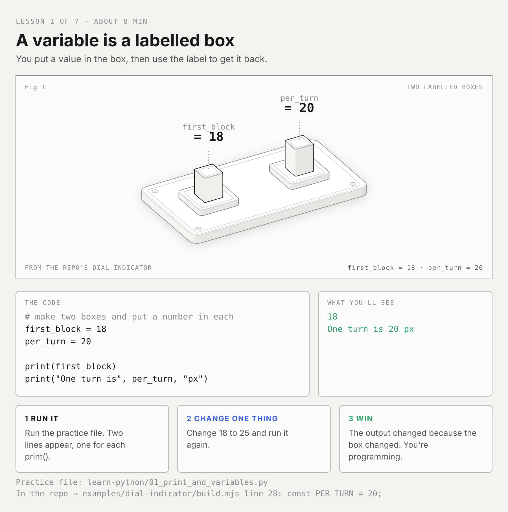
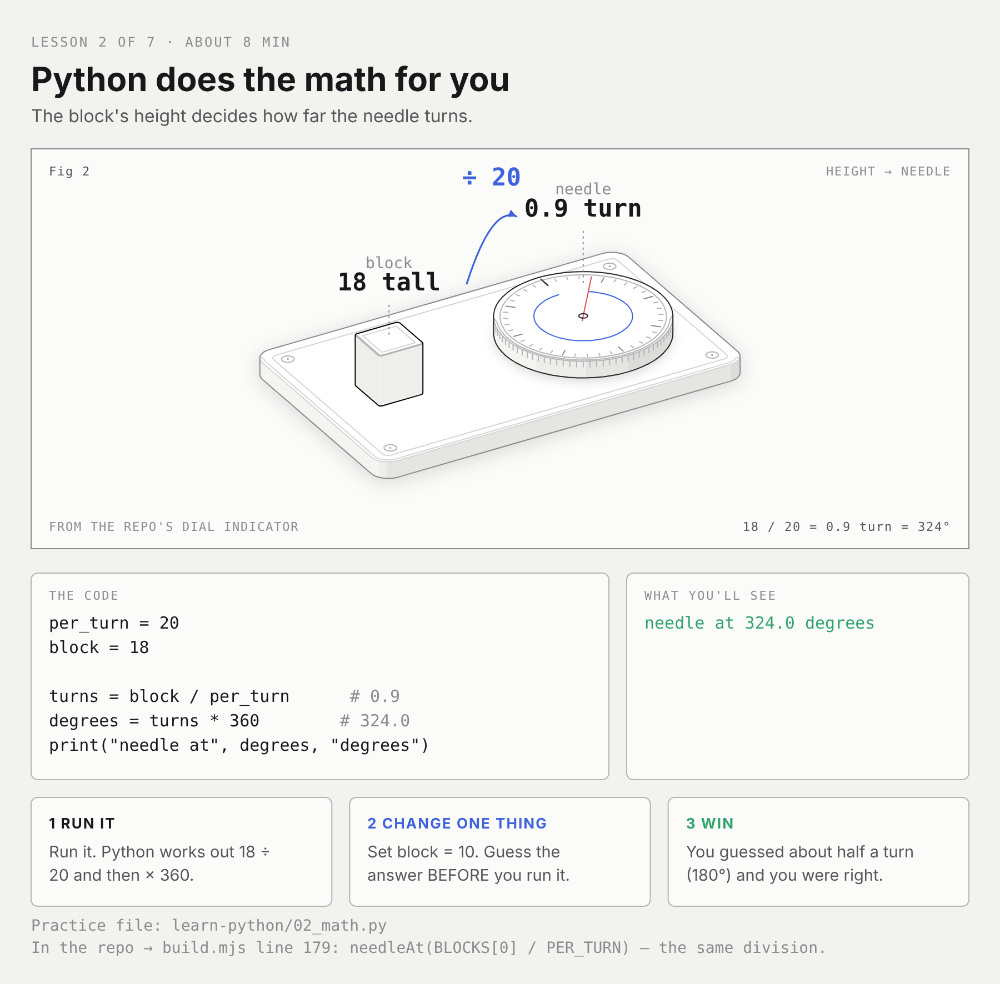
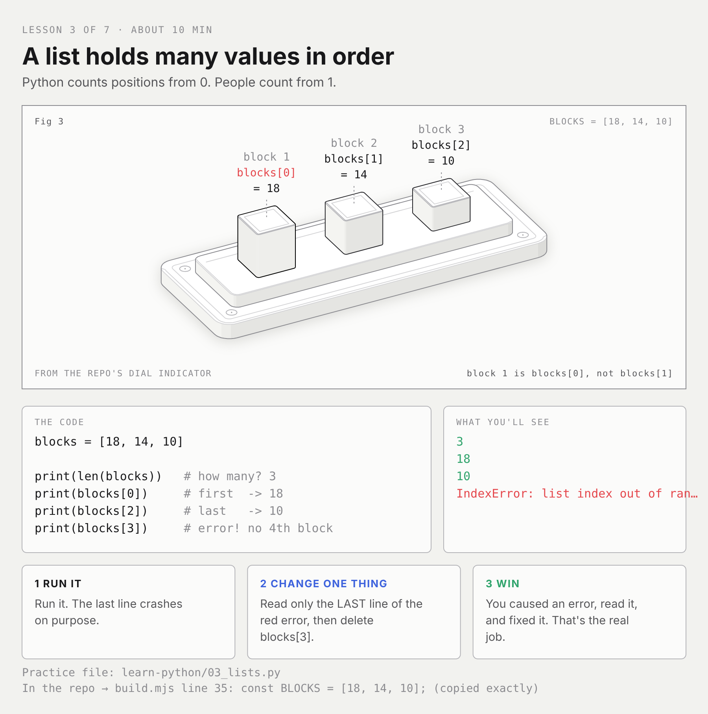
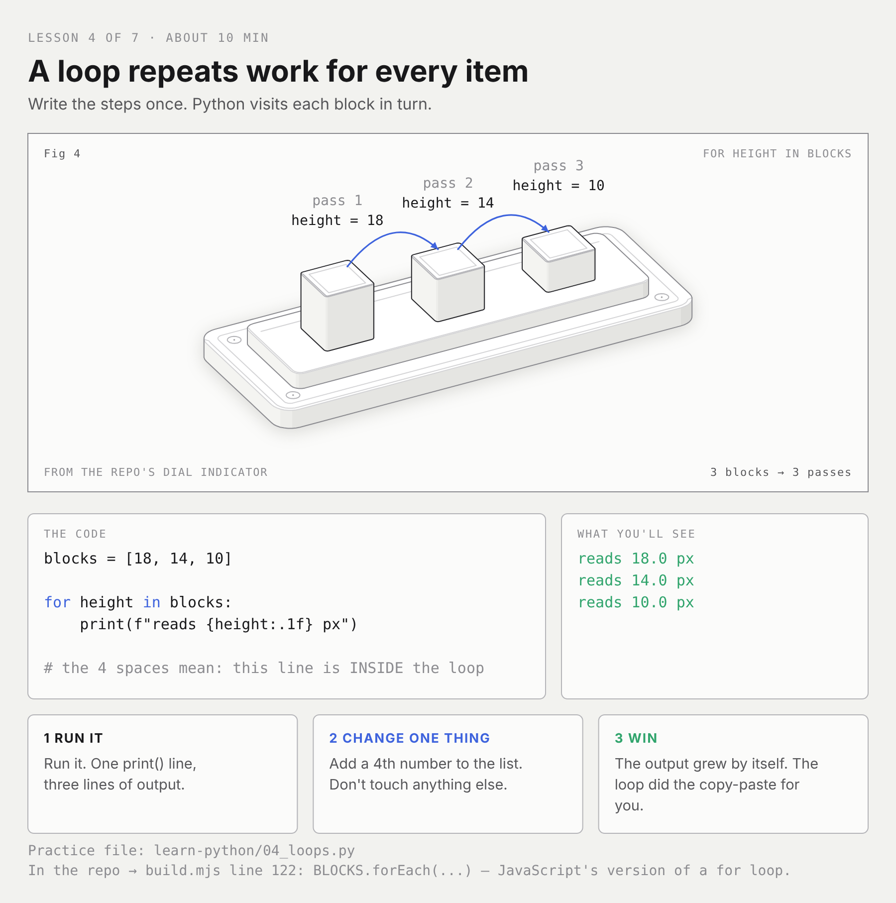
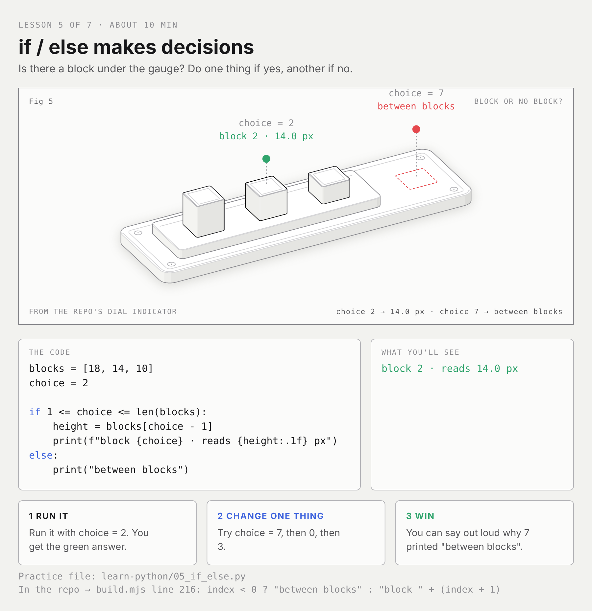
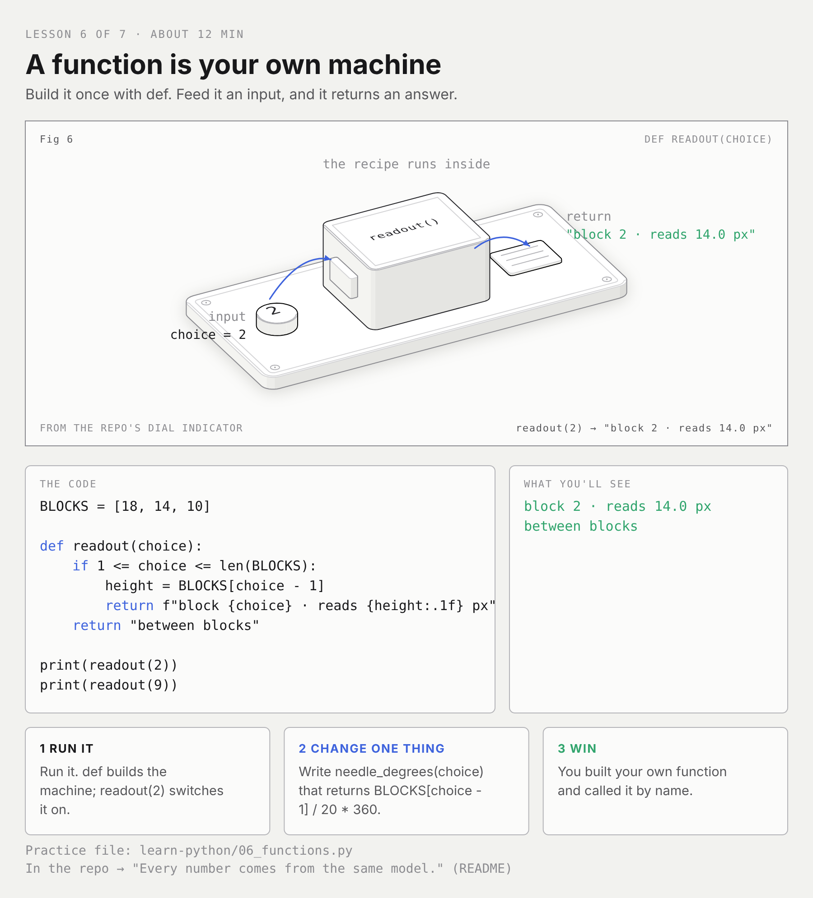
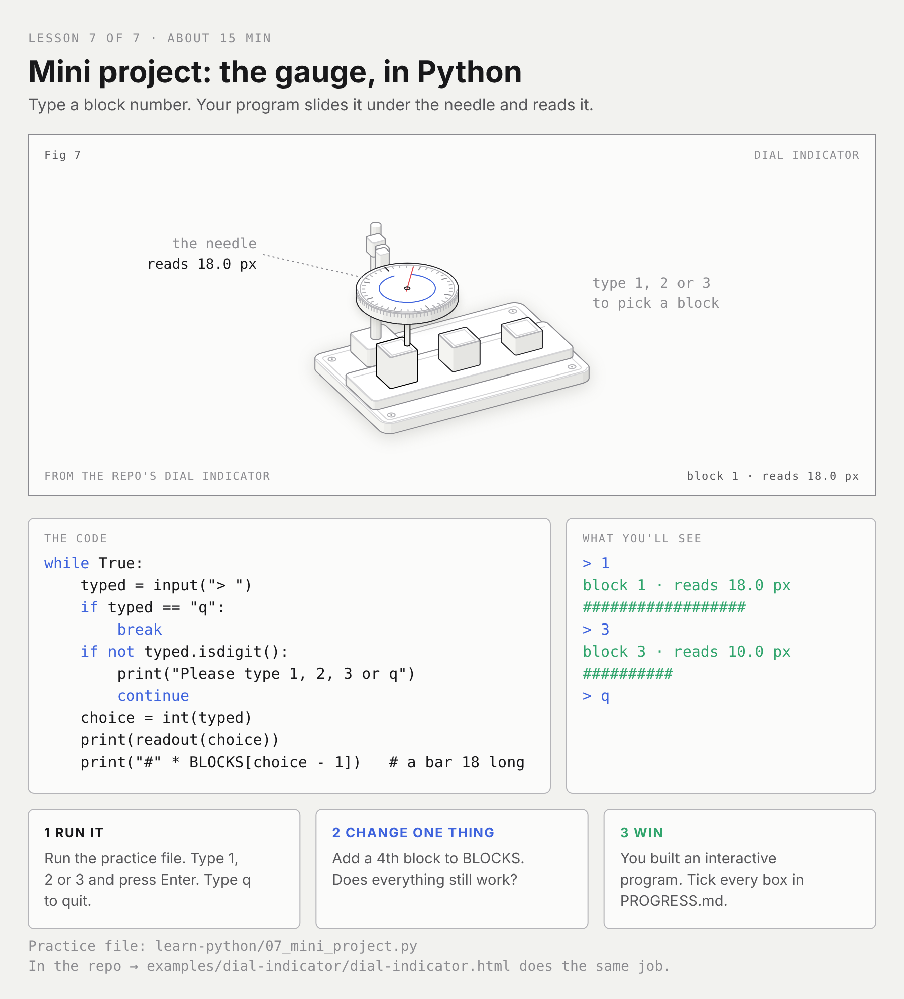

# Learn Python with the Dial Indicator

> **Start with the interactive version:** open [`python-bench.html`](python-bench.html)
> in a browser (download it, then double-click). You write Python in the page,
> press Run, and the dial indicator moves to match your code. Each lesson's
> challenge checks itself. Rebuild it with `node learn-python/interactive/build.mjs`.
>
> The cards and `.py` files below are the same lessons for offline practice.

You'll learn Python by rebuilding one small machine from this repo, the
**dial indicator** (`examples/dial-indicator/`), as Python code.

Open `examples/dial-indicator/dial-indicator.html` in a browser to see it.
Three metal blocks (18, 14 and 10 tall) slide under a gauge, and the
needle reads each block's height. By lesson 7 you'll have built that
gauge in Python.

## The rules (made for busy, distractible brains)

- **One lesson = one file = about 10 minutes.** Stop after one if you want.
  That still counts.
- **Each lesson has 3 steps:** ▶ RUN IT → ✏️ CHANGE ONE THING → ✅ WIN.
- **You're done with a lesson as soon as you get its WIN.** You don't have to
  finish the bonus.
- **Lost your place?** Open `PROGRESS.md` and look for the first unticked box.
- **Errors are normal.** Read the *last line* of the red text first. It
  usually says exactly what's wrong.

## How to run a lesson

In a terminal, from this folder:

```sh
python3 01_print_and_variables.py
```

(On Windows it may be `python` or `py` instead of `python3`.)

No terminal? Paste the file into https://www.online-python.com and press Run.

## The lessons

Each lesson is an **SVG card**, drawn with this repo's own isometric kit
(`kit/iso-kit.mjs`) in the same style as the dial indicator. Look at the
card first, then open its practice `.py` file and do the three steps.

| # | Card | Practice file | Time |
|---|------|---------------|------|
| 1 | [Variables](01-variables.svg) | `01_print_and_variables.py` | 8 min |
| 2 | [Math](02-math.svg) | `02_math.py` | 8 min |
| 3 | [Lists](03-lists.svg) | `03_lists.py` | 10 min |
| 4 | [Loops](04-loops.svg) | `04_loops.py` | 10 min |
| 5 | [if / else](05-if-else.svg) | `05_if_else.py` | 10 min |
| 6 | [Functions](06-functions.svg) | `06_functions.py` | 12 min |
| 7 | [Mini project](07-mini-project.svg) | `07_mini_project.py` | 15 min |









The cards are SVGs; the `png/` folder has picture copies that open in any app.
To redraw the SVGs after editing them: `node learn-python/build.mjs`
